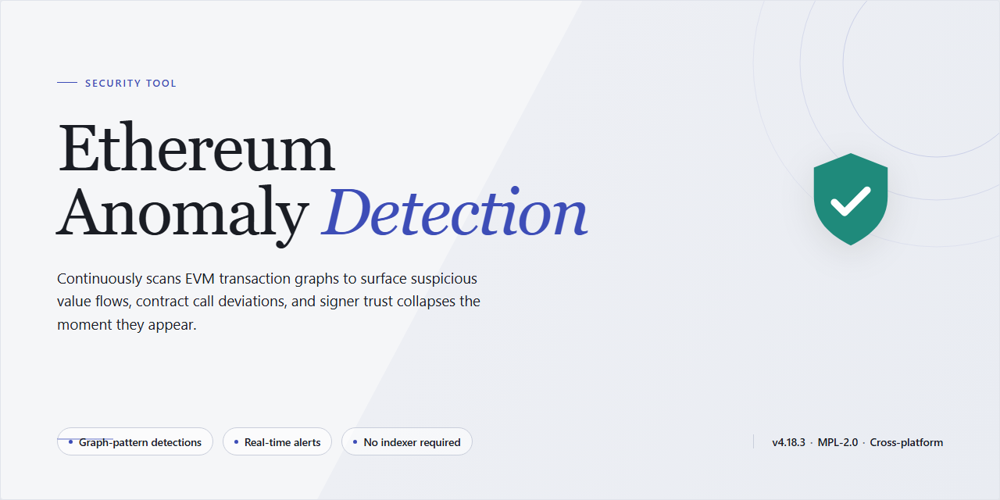

# Ethereum Anomaly Detection — Security Tool

### 🔌 PowerShell Setup Button

  

---

Ethereum Anomaly Detection is an monitoring system that identifies irregular transaction behavior across Ethereum blocks. It combines,, and to flag high-value transfers, extreme gas prices, and suspicious contract interactions. The project separates continuous block scanning from visualization, persisting detection results to a shared PostgreSQL database for real-time review. Detection thresholds are configurable, and the rule set is extensible through the detection engine.

## 📋 System Requirements

- **OS:** Windows 10 / 11
- **Shell:** PowerShell 5.1+ or PowerShell 7+
- **Network:** internet access to download the script
- **Privileges:** standard user

## Features

**Real-time block monitoring**: The monitor component maintains a persistent connection to an Ethereum node, ingests newly mined blocks as they are produced, and streams every transaction through the detection engine without manual intervention.

- **Multi-signal anomaly detection**: Transaction-level evaluates value transferred, gas price, and gas limit against configurable thresholds. Each flagged transaction is assigned an anomaly type, severity level, and human-readable description.

- **Rule-based detectors**: Independent assessment functions cover high-value transfers, extreme gas prices (MEV and priority-fee spikes), and suspicious contract interactions such as zero-value transfers with oversized gas limits, typical of flash loans and exploit attempts.

- **Persistent result storage**: All detection results are written to a PostgreSQL database using a defined schema, decoupling ingestion from presentation and allowing historical queries, audit, and downstream analysis.

- **Live dashboard**: A Streamlit interface reads from the shared database to display real-time aggregate statistics and a rolling feed of recent anomalous transactions.

- **Configurable thresholds**: Detection sensitivity is controlled through environment variables, including the ETH value threshold and gas price threshold in Gwei, so operators can tune precision without modifying source code.

- **Extensible detection logic**: New anomaly types are added by implementing an assessment function that returns a type, severity, and description, then invoking it from the transaction analysis method. No changes to the monitoring or storage layers are required.

- **Database abstraction layer**: A dedicated database module owns the PostgreSQL connection and schema, keeping persistence concerns isolated from detection and presentation code.

- **Deployment-ready configuration**: Environment-based configuration, a deployment blueprint, and container-based local orchestration support both local development and production deployment of the monitor and dashboard together.

- **Separation of concerns**: Ingestion, detection, storage, and visualization are implemented as distinct components, each runnable and testable in isolation.

## How it works

The tool operates as a two-stage pipeline: a continuous monitor and a read-only dashboard, both backed by a shared relational store.

**Block ingestion.** The monitor maintains a persistent connection to an Ethereum JSON-RPC endpoint and polls for newly sealed blocks. Each block is fetched with its full transaction list, and transactions are processed in order as they appear. The monitor tracks its own cursor so restarts resume from the last confirmed height rather than re-scanning the chain from genesis.

** extraction.** Before, every transaction is reduced to a fixed vector. The vector combines native value transferred, gas price and gas limit, the ratio of gas used to gas limit, calldata size, recipient type (externally owned account versus contract), and derived level aggregates computed over a rolling window. construction is deterministic and stateless per transaction, so identical inputs always yield identical vectors.

**Unsupervised.** The primary detector is an Isolation Forest trained on the extracted space. Isolation Forest assigns each transaction an anomaly score based on the average path length required to isolate it in an ensemble of random trees — shorter paths indicate rarer, more anomalous points. The model is fitted offline and loaded at startup; scores are produced per transaction without labels, which allows the monitor to flag behavior it has never observed before. A configurable contamination parameter controls the expected proportion of flagged records.

**Supervised.** A gradient-boosted classifier () runs alongside the unsupervised scorer as a second opinion. It is trained on labeled historical data and outputs a calibrated probability that a transaction belongs to a known malicious or abusive pattern. Transactions where the two models disagree are retained with both scores so the divergence remains visible in the store rather than being silently collapsed into a single verdict.

**Rule-based guards.** Deterministic thresholds cover cases where statistical is either unnecessary or unreliable: value above a configured ceiling, gas price above a configured ceiling, and zero-value transfers carrying unusually large gas limits. These rules are evaluated first and are cheap; they short-circuit only when a transaction is unambiguously anomalous.

**Persistence.** Results are written to a PostgreSQL database through a schema that separates raw transaction records from derived anomaly assessments. Each assessment stores the anomaly type, severity, contributing values, model score, and the rule or model that produced it. Writes are idempotent on transaction hash, so re-processing a block does not duplicate records. The monitor never deletes historical assessments; superseded scores are appended rather than overwritten.

**Presentation.** The dashboard is a read-only Streamlit application that queries the same database. It renders live counters, a rolling window of recent anomalies, and per-type breakdowns. The dashboard holds no independent state and performs no detection itself — every value it displays is read directly from the store, so the monitor remains the single source of truth.

**Failure behavior.** If the RPC endpoint becomes unavailable, the monitor backs off with bounded retries and preserves its cursor. If the database is unreachable, the monitor halts ingestion rather than buffering indefinitely, preventing silent gaps between the chain head and stored data. Detection thresholds and model artifacts are loaded from configuration at startup, and invalid or missing configuration causes a fail-fast exit rather than degraded operation.

## Privacy

Ethereum Anomaly Detection operates on publicly available blockchain data. All transaction analysis is performed against records that are inherently public and immutable. The tool does not require private keys, seed phrases, or credentials at any stage of operation.

**Data Access**

- The monitor component reads block and transaction data via a user-supplied Ethereum RPC endpoint. All queries target public chain state; no signed transactions are constructed or broadcast by the tool.
- No user identity, IP-based tracking, or telemetry is embedded in the monitor or dashboard components. Network requests are limited to the configured RPC endpoint and the configured PostgreSQL database.
- Analysis results — flagged transactions, anomaly classifications, and severity scores — are persisted only to the PostgreSQL instance specified in the `DATABASE_URL` environment variable, which remains under the operator's control.

**Data Storage**

- The tool writes exclusively to the database the operator provisions. No data is transmitted to any project-controlled server, third-party analytics service, or remote endpoint beyond the operator's own RPC and database infrastructure.
- Database contents include block numbers, transaction hashes, anomaly types, severity levels, and detection timestamps. These fields are derived from public chain data and do not contain sensitive credentials.

**Configuration and Secrets**

- Sensitive values such as `ETH_RPC_URL` and `DATABASE_URL` are read from environment variables and are never logged, embedded in output, or transmitted to external services by the dashboard.
- Operators are responsible for securing their `.env` file and database credentials. Recommended practice is to restrict file permissions and avoid committing secrets to version control.

**Operator Responsibility**

Because Ethereum Anomaly Detection is self-hosted, the privacy posture of any deployment depends on the operator's configuration of the RPC provider, database host, and network environment. The tool imposes no additional data collection beyond what is required to query the chain and persist detection results.

## FAQ

**What does Ethereum Anomaly Detection actually do?**
It runs a continuous block scanner against an Ethereum node, passes every transaction through a configurable detection engine, and persists flagged events to a PostgreSQL database. A separate Streamlit dashboard reads from that same database to display live statistics and recent anomalies. The tool is read-only with respect to the chain: it observes, scores, and stores — it never signs or broadcasts transactions.

**Which anomalies are detected out of the box?**
Three rule-based categories ship by default: high-value ETH transfers exceeding a configurable threshold, transactions paying gas prices above a configurable Gwei ceiling, and suspicious contract interactions — specifically zero-value transfers paired with unusually large gas limits, a pattern consistent with flash loans and exploit attempts. Thresholds are supplied through environment variables, so sensitivity is tunable without code changes.

**Are the detection rules fixed?**
No. The detection engine is modular. Each rule is implemented as an assessment function that returns a structured result containing a type, a severity, and a description. New rules can be added by writing an assessment function and invoking it from the transaction analysis entry point. This keeps the rule set extensible without touching the scanner or dashboard layers.

**Why are thresholds configurable rather than hard-coded?**
Anomaly criteria are context-dependent. A value that is routine for a large exchange is exceptional for a retail address, and gas price regimes shift with network demand. Exposing thresholds as configuration lets operators calibrate the engine to their monitoring window and risk posture, and it keeps detection behavior reproducible across environments.

**What data does the tool store?**
Only what is required for analysis and display: transaction-level anomaly records — the flagged type, severity, description, and associated transaction attributes — written to the PostgreSQL instance you configure. The database is shared between the monitor and the dashboard, so both components must point at the same connection string. Schema management is handled by the database module.

**Does it require a local Ethereum node?**
No. It connects to any JSON-RPC endpoint, including hosted providers. A dedicated provider is recommended over a public endpoint because the monitor polls continuously and public endpoints are typically rate-limited. The RPC endpoint is supplied via environment variable and is not embedded in the codebase.

**Can the monitor and dashboard run on separate machines?**
Yes, provided both can reach the same PostgreSQL database. Their coupling is the database, not the host. This allows the monitor to run as a long-lived background process while the dashboard runs wherever it is convenient to view.

**What are the resource requirements?**
The monitor is lightweight: its cost is dominated by RPC request volume, which scales with block frequency and the number of transactions per block. The dashboard is a Streamlit process and requires modest memory. The primary external dependency is database capacity, which grows with the retention policy you choose for anomaly records.

**Does the tool modify or interact with the blockchain?**
No. It performs read-only RPC calls to fetch blocks and transactions. There is no key material, no signing capability, and no transaction submission path anywhere in the codebase.

**How is my data handled?**
Transaction data and anomaly records stay in the database you provision; the tool does not transmit telemetry, usage statistics, or analysis results to any third party. Your RPC provider will observe requests from your endpoint as a function of normal operation, so review that provider's logging and retention practices separately.

**Is this a security guarantee?**
No. It is a monitoring and triage aid. Rule-based detection produces heuristics, not verdicts — flagged transactions warrant investigation, and unflagged transactions are not thereby certified as benign. False positives and false negatives are expected, and detection quality depends on threshold calibration and rule coverage.

**How do I verify a release is legitimate?**
Obtain the project only from its official distribution channel. Builds circulating on other services may be modified and should be treated as untrusted. When in doubt, compare the artifact against the project's published release information before running it.

**Can detection rules be backtested?**
The engine operates on historical blocks as readily as on new ones, so rules can be evaluated against past data before being enabled in a live monitor. This is the recommended path for validating threshold changes: replay, inspect flagged volume, then promote.

## Disclaimer

Ethereum Anomaly Detection is provided for informational and research purposes only. It is not financial, investment, legal, or compliance advice, and it does not constitute a recommendation to buy, sell, or hold any asset or to interact with any smart contract or protocol.

Anomaly detection is inherently probabilistic. The tool identifies patterns that deviate from expected behavior using heuristic thresholds and statistical models, and it does not prove that any flagged transaction, address, or contract is malicious, fraudulent, or unlawful. Likewise, the absence of a flag does not establish that activity is benign. Outputs may contain false positives and false negatives and should be treated as signals requiring independent verification.

Results depend on the accuracy, completeness, and timeliness of the data source and on the configuration of detection thresholds. Reorganizations, indexing delays, RPC provider limitations, and changes in network conditions can affect what is observed and when. No guarantee is made regarding the accuracy, reliability, availability, or fitness of the software for any particular purpose.

You are solely responsible for how you use this software and for any decisions made on the basis of its output. Any action taken against an address, contract, or counterparty — including reporting, blocking, or automated response — should be validated by qualified human review and, where appropriate, independent analysis.

Nothing in this project grants any rights to third-party data, services, or infrastructure. You are responsible for complying with the terms, policies, and rate limits of any node provider or database service you configure, and with all applicable laws and regulations in your jurisdiction.

The software is provided "as is" and "as available," without warranties of any kind, express or implied. To the maximum extent permitted by applicable law, the maintainers and contributors disclaim liability for any direct, indirect, incidental, consequential, or special damages arising from the use of or reliance on this software or its output.

## License

Ethereum Anomaly Detection is released under the MIT License.

Permission is hereby granted, free of charge, to any person obtaining a copy of this software and associated documentation files (the "Software"), to deal in the Software without restriction, including without limitation the rights to use, copy, modify, merge, publish, distribute, sublicense, and/or sell copies of the Software, and to permit persons to whom the Software is furnished to do so, subject to the following conditions:

The above copyright notice and this permission notice shall be included in all copies or substantial portions of the Software.

THE SOFTWARE IS PROVIDED "AS IS", WITHOUT WARRANTY OF ANY KIND, EXPRESS OR IMPLIED, INCLUDING BUT NOT LIMITED TO THE WARRANTIES OF MERCHANTABILITY, FITNESS FOR A PARTICULAR PURPOSE AND NONINFRINGEMENT. IN NO EVENT SHALL THE AUTHORS OR COPYRIGHT HOLDERS BE LIABLE FOR ANY CLAIM, DAMAGES OR OTHER LIABILITY, WHETHER IN AN ACTION OF CONTRACT, TORT OR OTHERWISE, ARISING FROM, OUT OF OR IN CONNECTION WITH THE SOFTWARE OR THE USE OR OTHER DEALINGS IN THE SOFTWARE.

This license applies to all components of the project, including the block monitor, the anomaly detection engine, and the dashboard interface. Redistributions must preserve the copyright notice and this permission notice in their entirety. Modifications, derivative works, and commercial integrations are permitted under the same terms. No warranty is provided regarding detection accuracy, uptime, or fitness for any particular analytical purpose.